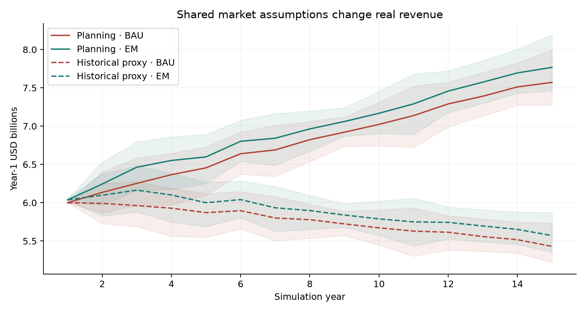
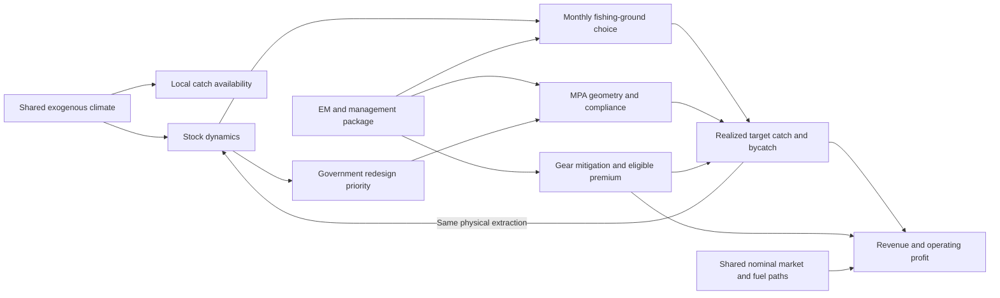
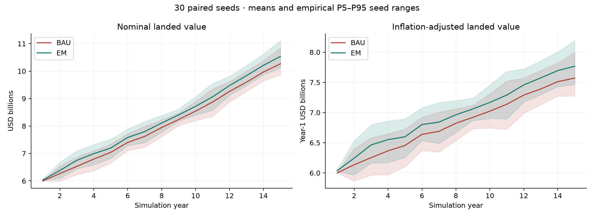
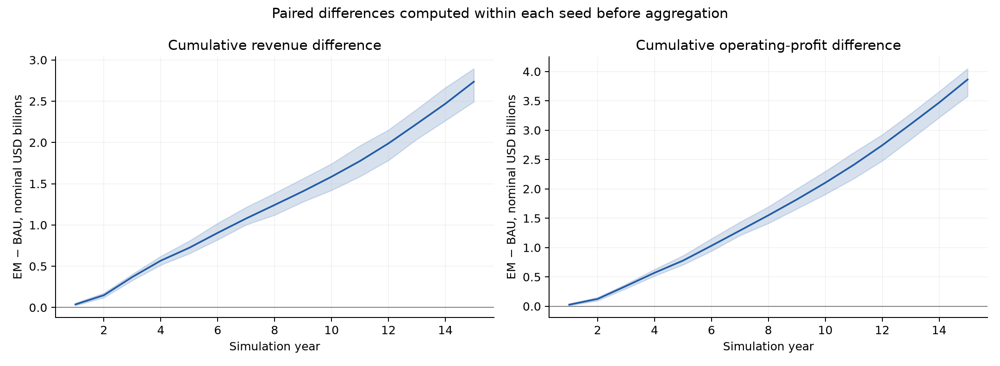
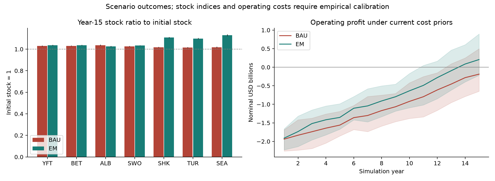

# Comprehensive fisheries model and multi-simulation evaluation report

**Project:** Blurgs Global Fisheries Digital Twin
**Updated:** 2 November 2026
**Implementation:** `coupled-stock-v3`; global engine used by the app
**Evidence:** 80 paired 15-year runs (160 simulated worlds), comprising 30 positive-real-growth default pairs, 30 historical-proxy comparison pairs, 10 zero-control pairs and 10 stress pairs.

## 1. Executive assessment

Across 30 default seeds, mean Year-15 nominal landed value is **$10.268B for BAU** and **$10.535B for the EM policy package**. Mean per-run nominal CAGR is **3.91%** and **4.05%**, respectively. Inflation-adjusted CAGRs are **1.67%** and **1.81%** under the assumed 2.2% annual deflator.

The mean 15-year paired landed-value difference is **$+2.74B**, with an empirical P5–P95 seed range of **[$+2.49B, $+2.89B]**. The mean operating-profit difference is **$+3.86B**. A positive profit difference can mean a smaller operating loss: Year-15 profits are positive in **7/30 BAU seeds** and **22/30 EM seeds** under the current costs.

All **10/10 zero-control pairs match exactly**, with maximum monthly numerical difference **0**. Stress scenarios can still decline substantially. These checks support internal consistency; the model's parameters, fleet margins and intervention effects remain subject to empirical calibration.

Albacore has a lower final modeled stock ratio under EM than BAU across these seeds, so the package does not improve every target species. Section 8 reports this tradeoff explicitly.

This report replaces the earlier single-run tables, large dividend claims, biological recovery percentages and validation verdicts. Old screenshots, GIFs and report figures are excluded from the current evidence. Every figure below was generated from this ensemble.

## 2. Experimental design and statistical interpretation

The default ensemble uses seeds `42 + 1009*i`, for `i=0,...,29`. The historical-proxy comparison uses the same 30 seeds. Zero-control and stress experiments each use the first 10 seeds from that list. Every seed runs a matched BAU and EM world with the same initial fleet, climate, market and biological shocks. The installed world contains **316 cells**. The full configuration and input hashes are in the [run manifest](results/ensemble_v3/manifest.json).

| Setting | Value |
| --- | --- |
| Horizon / registered vessels / representative agents | 15 years / 7,288 / 1,500 |
| EM adoption / awareness / premium ceilings | 75% / 75% / 10% |
| Government MPA / reallocation / enforcement pushes | 25% / 30% / 30% |
| Climate extremity ceiling | 35% |
| Baseline annual landed value | $6.0B nominal, calibrated separately per seed |
| Nominal price prior / inflation assumption | 3.7330% / 2.20% per year |
| Price / fuel annual lognormal sigma | 0.02 / 0.03 |
| Exploitation prior / initial stock fraction | 0.035 / 0.70 of K |
| Policy phase-in / EM rollout / audit premium maturity | 60 / 36 / 24 months |
| Discount rate | 7% nominal per year |
| Animation agents / frame interval | 0 / 180 months; simulation still updates every month |

Only seeds vary within an experiment. Stochastic variation includes fleet composition and traits, grounds, adoption heterogeneity, climate, catch, prices and biological noise. Model coefficients are fixed. Each seed receives its own pre-policy first-year $6B calibration, so first-year BAU revenue variation is removed by construction. EM Year 1 can differ because intervention rollout starts immediately.

All tables report arithmetic means. Brackets denote the empirical **5th and 95th percentiles across seeds**, using NumPy's default linear interpolation. They are 90% seed ranges, not confidence intervals for the mean, observed-world prediction intervals or uncertainty over model parameters. Tail estimates are coarse with 30 default seeds and especially 10 sensitivity seeds. Seeds are reproducible pseudorandom replications, not independent observed fisheries.

Paired effects are calculated as `EM(seed) - BAU(seed)` before summarizing. Mean percentage effects average within-seed ratios; they are not ratios of ensemble means. Positive-effect counts describe these simulated seeds, not calibrated probabilities of real-world success. CAGR uses 14 intervals between Year 1 and Year 15 and is computed per seed before averaging.

## 3. Positive real growth, historical comparison and monetary units

The historical context is rounded global capture first-sale value: about **$151B in 2018**, **$141B in 2020** and **$159B in 2022**. Sources are [FAO SOFIA 2020](https://doi.org/10.4060/ca9229en), [FAO SOFIA 2022](https://www.fao.org/4/cc0461en/online/sofia/2022/world-fisheries-aquaculture.html) and [FAO SOFIA 2024](https://doi.org/10.4060/cd0683en); the 2018 estimate is also reported in [PNAS 2021](https://pmc.ncbi.nlm.nih.gov/articles/PMC8346865/).

The **default is a positive-real-growth planning scenario**, with 1.5% annual real price growth and 2.2% assumed inflation. Nominal prices compose multiplicatively:

```
nominal price growth = (1 + real price growth) * (1 + inflation) - 1
                    = 1.015 * 1.022 - 1 = 3.733% per year
```

This is the requested growth assumption, shared by BAU and EM; it is not an estimate from historical data. Prices and stock dynamics still determine realized revenue. Neither annual nor cumulative real revenue is clamped to an upward path.

For comparison, `(159/151)^(1/4)-1` is approximately **1.30% nominal annual endpoint growth**. Under approximately stable reference catch, this supplies the separate historical-proxy price scenario. It is not a measured longline price series or a statistical fit to annual observations. The pandemic decline is retained as historical context; its subsequent rebound is not extrapolated alone. Cross-edition coverage and revisions differ, including algae in the 2024 capture summary. Global capture values include inland fisheries and do not independently validate the $6B longline anchor.

Total fisheries production, aquaculture, seafood trade receipts, GDP/value added and wild-capture ex-vessel revenues are different quantities. A World Bank 1–2% real-revenue guarantee is not established. [OECD–FAO 2026–2035](https://www.oecd.org/en/publications/oecd-fao-agricultural-outlook-2026-2035_47874669-en/full-report/fish-and-other-aquatic-products-for-human-consumption_be23d26b.html) projects capture-fisheries real prices below the 2023–2025 average by 2035. The planning default is therefore explicitly a positive-real-growth scenario rather than an attribution to that outlook.

`landed_value`, operating profit and costs use nominal USD. `real_landed_value = landed_value/(1+inflation)^(year-1)`. Real growth is `(1+nominal_growth)/(1+inflation)-1`. Inflation is not added a second time to nominal revenue. The 2.2% deflator is a scenario assumption. Cumulative nominal values sum each year's dollars without discounting; discounted profit uses 7% nominal discounting, with Year 1 undiscounted.

### Seed-matched market comparison

| Shared market scenario | World | Nominal revenue CAGR mean [P5, P95] | Real revenue CAGR mean [P5, P95] | Year-15 real revenue ($B) mean [P5, P95] |
| --- | --- | --- | --- | --- |
| Positive real growth: planning assumption | BAU | 3.91% [3.62, 4.32] | 1.67% [1.39, 2.07] | 7.572 [7.276, 7.997] |
| Positive real growth: planning assumption | EM | 4.05% [3.77, 4.46] | 1.81% [1.53, 2.21] | 7.768 [7.463, 8.190] |
| Historical nominal proxy: comparison | BAU | 1.47% [1.19, 1.87] | -0.71% [-0.99, -0.32] | 5.430 [5.218, 5.736] |
| Historical nominal proxy: comparison | EM | 1.61% [1.33, 2.01] | -0.57% [-0.85, -0.19] | 5.571 [5.352, 5.874] |

Both market scenarios use the same seed list, 2.2% deflator and physical/policy coefficients. The historical-proxy comparison can have declining real revenue because its nominal price trend is below inflation. Changing the market assumption does not change the deflation formula or force the output to grow. Prices do not drive fleet entry or exit in the current engine.



## 4. Corrected model architecture and coupling



### Fleet, habitat and space

Synthetic vessel traits include fishing effort, capacity, catchability, fuel intensity, monthly fixed and crew costs, target species and latent risk. Ground selection combines historical preferences, biomass attraction, persistence, crowding, legal aversion and exploration. Choices are restricted to resident target habitat. Effort now uses mean-one lognormal noise with bounded depletion and management responses, replacing the expression that almost always hit its upper cap.

A map coordinate is the monthly fishing cell used for catch and enforcement. The model does not render an intermediate position while crediting catch at an unreached destination. Monthly relocation contributes to fuel demand, but voyage routes and coastal navigation are not modeled. Fishing days are bounded by average calendar days per month.

Installed MPA polygons use the same dateline-aware transformed geometry for the map and point membership, including holes. Cell-center membership remains a coarse-grid approximation. Redesign requires an enabled government push; reserves without nearby fleet presence hold their previous boundary. A coarse fractional protection fallback is explicit when polygons are unavailable.

### Physical extraction, growth and migration

Resident global cells start at `B0 = 0.70*K`; nonresident cells have `B=K=0`. Stock-index conversion factors are inferred from expected reference catch and equilibrium monthly surplus production, not measured biomass. Higher exploitation pressure implies a smaller physical stock supporting the initial fleet. The core balance is:

```
requested cell extraction = sum(vessel catch * vessel weight)
realized catch = requested catch * min(1, available stock/requested extraction)
removal in stock-index units = realized physical extraction / fixed stock conversion
remaining stock = clip(B + (r/12)*B*(1-B/K) - removal - climate loss + noise, 0, K)
next stock = remaining stock + conservative neighboring-cell exchange
```

Every target tonne sold removes that tonne from the stock ledger. Bycatch mitigation reduces incidental extraction before the same accounting step. Protection reduces fishing access before capture, without applying another mortality discount to already recorded catch. Exchange uses remaining stock after harvest and growth, with matched donor debits and receiver credits and limits on availability and space. There is no independent spillover-creation term or artificial positive stock floor. Growth is net surplus production; the retained species natural-mortality field is informational.

### Climate, compliance, management and markets

Climate follows a bounded AR(1) anomaly with occasional extreme jumps. It changes catch availability within fixed habitat envelopes; additional stock mortality is `max(abs(climate)-0.20,0)^2 * sensitivity * B/12`. Habitat capacity itself does not migrate poleward. These response coefficients remain scenario assumptions.

Awareness reduces latent non-compliance through the selected effect. EM adoption also enables modeled gear mitigation, observability and premium eligibility. Government enforcement, MPA redesign and reallocation support are separate controls. Adoption phases in over 36 months, premium audit maturity over 24, and policy ramps use fixed elapsed months rather than the selected endpoint. Actual adoption stays below its ceiling; final realized adoption across default seeds averages **60.0%**, with P5–P95 **[57.9%, 61.9%]**.

Current supply is compared with a fixed reference supply, preserving a scarcity-price effect when reduced supply persists. There is no automatic BAU trade-sanction penalty. Revenue is realized catch multiplied by nominal price, stock quality, eligible premium and supply adjustment. Operating profit subtracts fuel, monthly fixed/crew costs, variable costs, EM costs and fines. Monthly costs are charged monthly; nonfuel costs and EM service fees receive assumed inflation.

The paired comparison estimates the effect of this entire modeled intervention package conditional on its assumptions. It does not identify monitoring's real-world causal effect, nor isolate awareness, gear, government policy or premiums individually. Detailed current specifications are in [GLOBAL_MODEL.md](GLOBAL_MODEL.md), [BIOLOGY.md](BIOLOGY.md) and [MODEL_CORRECTIONS.md](MODEL_CORRECTIONS.md).

## 5. Aggregate default results: 30 paired seeds

| Metric | BAU mean [P5, P95] | EM package mean [P5, P95] |
| --- | --- | --- |
| Year-1 landed value ($B) | 6.000 [6.000, 6.000] | 6.037 [6.024, 6.054] |
| Year-15 landed value ($B) | 10.268 [9.868, 10.846] | 10.535 [10.121, 11.108] |
| Year-15 real landed value (year-1 $B) | 7.572 [7.276, 7.997] | 7.768 [7.463, 8.190] |
| Nominal revenue CAGR, Years 1–15 | 3.91% [3.62, 4.32] | 4.05% [3.77, 4.46] |
| Real revenue CAGR, Years 1–15 | 1.67% [1.39, 2.07] | 1.81% [1.53, 2.21] |
| 15-year cumulative landed value ($B) | 120.36 [116.78, 123.49] | 123.10 [119.55, 126.17] |
| 15-year cumulative operating profit ($B) | -16.86 [-22.60, -11.70] | -13.00 [-18.54, -8.02] |
| Year-15 operating profit ($B) | -0.19 [-0.65, 0.50] | 0.21 [-0.22, 0.90] |
| Year-15 catch (million tonnes) | 1.170 [1.136, 1.204] | 1.162 [1.131, 1.199] |
| 15-year fishing days (million) | 22.267 [22.061, 22.577] | 21.684 [21.492, 21.996] |
| Year-15 revenue per fishing day ($) | 6,916 [6,691, 7,334] | 7,358 [7,056, 7,800] |
| Year-15 illegal-entry events | 609 [554, 663] | 119 [80, 171] |
| Year-15 high-bycatch event index | 45,339 [45,245, 45,454] | 24,015 [22,255, 25,749] |



The planning default increases inflation-adjusted revenue over the horizon across the ensemble. Individual years can still decline with market or ecological variability. The historical comparison demonstrates that positive real growth depends on the selected economic assumption; stock and catch responses remain endogenous.

## 6. Within-seed intervention differences

| Within-seed effect | Mean [P5, P95] | Seeds with effect > 0 |
| --- | --- | --- |
| Cumulative landed-value difference ($B) | 2.74 [2.49, 2.89] | 30/30 |
| Cumulative landed-value difference (%) | 2.27% [2.08, 2.46] | 30/30 |
| Cumulative real landed-value difference (year-1 $B) | 2.31 [2.10, 2.46] | 30/30 |
| Cumulative operating-profit difference ($B) | 3.86 [3.58, 4.05] | 30/30 |
| Discounted operating-profit difference ($B) | 2.26 [2.11, 2.39] | 30/30 |
| Year-15 landed-value difference ($M) | 266.6 [217.6, 316.5] | 30/30 |
| Year-15 operating-profit difference ($M) | 393.5 [334.3, 447.6] | 30/30 |
| 15-year fishing days saved (thousands) | 582.7 [554.4, 610.6] | 30/30 |
| Year-15 illegal-entry reduction (%) | 80.54% [73.36, 86.09] | 30/30 |
| Year-15 high-bycatch index reduction (%) | 47.03% [43.22, 50.89] | 30/30 |

For difference rows the sign is EM minus BAU. Days saved and event reductions are defined in the opposite direction so positive values indicate fewer days or events under EM. A positive profit effect means higher profit or a smaller loss. It does not establish commercially viable fleet economics.



## 7. Year-by-year ensemble means

| Year | BAU revenue, mean $B | EM revenue, mean $B | Paired revenue effect, mean [P5, P95] $M | BAU profit, mean $B | EM profit, mean $B |
| --- | --- | --- | --- | --- | --- |
| 1 | 6.000 | 6.037 | +37.2 [+24.2, +53.9] | -1.938 | -1.912 |
| 2 | 6.270 | 6.382 | +111.7 [+89.2, +137.3] | -1.833 | -1.735 |
| 3 | 6.531 | 6.752 | +220.8 [+191.7, +243.8] | -1.739 | -1.519 |
| 4 | 6.796 | 6.994 | +198.2 [+169.7, +231.6] | -1.643 | -1.417 |
| 5 | 7.043 | 7.199 | +155.6 [+120.3, +182.8] | -1.561 | -1.353 |
| 6 | 7.403 | 7.584 | +181.3 [+137.2, +227.4] | -1.360 | -1.106 |
| 7 | 7.623 | 7.797 | +174.3 [+136.7, +214.6] | -1.302 | -1.043 |
| 8 | 7.946 | 8.110 | +163.7 [+111.4, +191.3] | -1.170 | -0.910 |
| 9 | 8.238 | 8.404 | +166.1 [+121.0, +225.1] | -1.066 | -0.796 |
| 10 | 8.543 | 8.719 | +176.3 [+133.7, +216.8] | -0.921 | -0.637 |
| 11 | 8.874 | 9.064 | +190.0 [+133.9, +231.8] | -0.796 | -0.490 |
| 12 | 9.262 | 9.475 | +213.4 [+143.7, +263.3] | -0.613 | -0.280 |
| 13 | 9.597 | 9.835 | +238.6 [+170.8, +296.6] | -0.455 | -0.095 |
| 14 | 9.969 | 10.212 | +242.7 [+189.6, +294.4] | -0.281 | 0.086 |
| 15 | 10.268 | 10.535 | +266.6 [+217.6, +316.5] | -0.187 | 0.206 |

These rows average the same seeds each year. They are not a representative single trajectory and their year-to-year changes are not the average per-seed CAGR. Complete annual seed rows and distribution summaries are linked in Section 11.

## 8. Species, bycatch and compliance

| Species | Code | BAU mean stock ratio | EM mean stock ratio | Paired ratio difference, mean [P5, P95] |
| --- | --- | --- | --- | --- |
| Yellowfin tuna | YFT | 1.030 | 1.036 | +0.006 [+0.005, +0.007] |
| Bigeye tuna | BET | 1.031 | 1.037 | +0.006 [+0.005, +0.008] |
| Albacore tuna | ALB | 1.037 | 1.026 | -0.011 [-0.013, -0.009] |
| Swordfish | SWO | 1.026 | 1.033 | +0.007 [+0.006, +0.008] |
| Sharks (aggregate) | SHK | 1.018 | 1.107 | +0.089 [+0.085, +0.094] |
| Marine turtles (index) | TUR | 1.015 | 1.098 | +0.083 [+0.079, +0.087] |
| Seabirds (index) | SEA | 1.017 | 1.128 | +0.111 [+0.105, +0.116] |

Stock ratios divide each species' total modeled physical stock by its own initial total; 1 means no net change. The difference is in ratio units: +0.01 corresponds to one percentage point of initial stock. It is not a percent increase relative to BAU. These synthetic indices are not field stock assessments, observed animal counts, IUCN classifications or evidence of prevented extinction.

The albacore mean ratio is lower under the default EM package than BAU, with a negative P5–P95 paired difference, while the three bycatch-species ratios are higher. This is a modeled tradeoff, not a claim that every stock benefits. Attribution to particular management or displacement channels would require further component ablations.

The high-bycatch event index counts vessel-species amounts above a contemporaneous threshold based on unmitigated bycatch. Its reduction is not a calibrated estimate of animal mortality. Illegal-entry events likewise describe synthetic behavior and cannot substantiate accusations about real vessels. Government boundaries, vessel avoidance, awareness and gear assumptions jointly influence these outcomes.



## 9. Zero-control and exploitation-pressure checks

| Experiment | World | Seeds | Year-15 landed value, $B mean [P5, P95] | Nominal CAGR mean [P5, P95] |
| --- | --- | --- | --- | --- |
| All controls zero; climate zero | BAU | 10 | 10.282 [9.889, 10.851] | 3.92% [3.63, 4.32] |
| All controls zero; climate zero | EM | 10 | 10.282 [9.889, 10.851] | 3.92% [3.63, 4.32] |
| 4× pressure; zero price drift | BAU | 10 | 0.383 [0.367, 0.404] | -17.85% [-18.10, -17.54] |
| 4× pressure; zero price drift | EM | 10 | 0.906 [0.864, 0.955] | -12.66% [-12.94, -12.32] |

Zero-control runs set adoption, awareness, premium, government MPA push, reallocation support, enforcement and climate extremity to zero. All 10 pairs match exactly in monthly numerical outputs: **maximum paired difference 0**. The unit suite separately checks identity with nonzero shared climate and compares annual, species, vessel and animation outputs.

Stress runs set exploitation pressure to four times the reference prior and nominal price drift to zero, retaining the other default controls. They are diagnostic scenarios, not estimates of the probability of future collapse. Their declining paths demonstrate that first-year calibration does not force later revenue growth. Ten runs per check give only a coarse sensitivity summary.

Across all 80 pairs, the maximum first-year BAU anchor error is **$0.000001**, and maximum monthly mismatch between target catch and stock-removal ledgers is **2.91e-11 tonnes**. [Validation summary](results/ensemble_v3/validation_summary.json) records these checks.

## 10. Economic, livelihood and supply-chain limits

Operating losses remain material under the current monthly cost assumptions. There is no fleet exit, entry, subsidy or financing process that would reconcile persistent losses with continued operation. A positive EM-minus-BAU profit difference therefore cannot be presented as a validated return on investment. Revenue calibration does not calibrate operating margins.

Crew costs are fixed monthly inputs in this engine; it does not implement a 28–35% revenue-sharing contract, employment transitions, wage distribution or labor-rights outcomes. The earlier multi-billion-dollar crew-income claims are removed. Those claims require an explicit livelihood model and observed compensation data.

The separate `sim/supply_chain.py` module contains deterministic illustrative assumptions about port delays, spoilage, regulatory clearance, retail premiums and carbon intensity. Those downstream states are not jointly simulated by this global ensemble. This report does not add them to landed value or fleet profit or carry forward claims of regulatory compliance, carbon reductions, fraud prevention or brand equity. No current competitor comparison is inferred from simulation output.

Other limits include fixed fleet size, coarse MPA/cell geometry, simplified habitat connectivity, inferred biomass units, fixed life-history parameters, a broad historical price proxy and no structural-parameter uncertainty ensemble. No regional-engine ensemble is claimed here; that engine is covered by separate consistency tests. Calibration against RFMO catch/effort, species prices, observer/bycatch data and vessel operating accounts remains necessary before forecasting or policy appraisal.

## 11. Reproduction, artifacts and verification

Run from the repository root:

```bash
OPENBLAS_NUM_THREADS=1 OMP_NUM_THREADS=1 MPLCONFIGDIR=/tmp/ems-mpl uv run --no-sync python scripts/aggregate_model_report.py
uv run --no-sync python scripts/render_ensemble_report.py
uv run --no-sync pytest -q
```

The ensemble runner uses two local worker processes, the installed pack and no external downloads. Saved source/data SHA-256 hashes identify the exact implementation used even in a working tree with uncommitted changes. `aggregate_model_report.py --reuse` rebuilds summaries and figures without simulations and rejects changed simulation/data inputs. The renderer also checks these hashes. Run the full ensemble again after any model or data change.

| Artifact | Contents |
|---|---|
| [Manifest](results/ensemble_v3/manifest.json) | Configurations, exact seed lists, versions and source/data hashes |
| [Annual runs](results/ensemble_v3/annual_runs.csv) | Every experiment/seed/scenario/year |
| [Run metrics](results/ensemble_v3/run_metrics.csv) | CAGRs, cumulative values, final states and accounting checks |
| [Run summaries](results/ensemble_v3/run_summary.csv) | Count, mean, median, standard deviation, P5 and P95 |
| [Paired run differences](results/ensemble_v3/paired_run_differences.csv) | Within-seed effects before aggregation |
| [Paired summaries](results/ensemble_v3/paired_summary.csv) | Effect distributions and positive-effect counts |
| [Yearly summaries](results/ensemble_v3/yearly_summary.csv) | Annual means and empirical ranges |
| [Species runs](results/ensemble_v3/species_runs.csv) | All annual species indices |
| [Species summaries](results/ensemble_v3/species_final_summary.csv) | Final species means and paired differences |
| [Identity checks](results/ensemble_v3/identity_checks.csv) | Per-pair null-control comparisons |
| [Validation summary](results/ensemble_v3/validation_summary.json) | Baseline anchor, extraction ledger and null checks |

The current unit suite contains 34 passing tests covering extraction accounting, migration conservation and bounds, extinction floors, polygon holes and dateline membership, habitat/position consistency, adoption ceilings, inflation conversion and composition, real-revenue invariance to inflation with matched real growth, both market scenarios, zero-policy identity and horizon prefixes in both engines. Those tests and the ensemble checks verify specified mathematical behavior; they do not constitute empirical fisheries validation.
