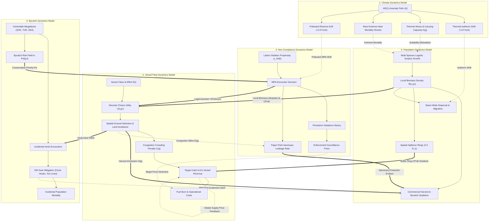

# Global Fisheries Digital-Twin Model: Coupled Multi-Model Architecture

## 1. Executive Summary & Plain-Language Overview

The simulator models global longline fisheries as a **fully coupled, closed-loop socio-ecological system**. Rather than treating fishing fleets, fish stocks, compliance, bycatch, and climate as independent static modules, the simulator explicitly couples **5 dynamical sub-models**:

The system instantiates thousands of synthetic longliner agents across four calibrated size classes (Small coastal, Medium regional, Large industrial, Distant-water freezer). Every simulated month, each sub-model exchanges state variables bidirectionally with other sub-models.

---

## 2. Model 1: Climate Dynamics Model

Climate variability is simulated as a bounded autoregressive stochastic process with rare extreme anomaly shocks:

$$
c_t = \rho \, c_{t-1} + \epsilon_t + J_t, \qquad |c_t| \le c_{\max}
$$

where:
- $\rho = 0.60$ is the autoregressive anomaly persistence.
- $\epsilon_t \sim \mathcal{N}\left(0, \left(\frac{c_{\max}}{8}\right)^2\right)$ represents monthly climate noise.
- $J_t$ is a rare jump process triggering extreme climatic events (e.g., El Niño / Marine Heatwaves) with probability $p = 0.025$, where $J_t \sim \pm \text{Uniform}(0.35 c_{\max}, c_{\max})$.
- $c_{\max} \in [0.0, 1.0]$ is the user-configured climate extremity ceiling.

### Couplings to Other Sub-Models:
1. **To Population Dynamics (Thermal Isotherm Shift):** Climate anomalies displace the thermal suitability centroid latitudinally:
   $$
   \Delta \text{lat}_t = c_t \times 12.0^\circ
   $$
   Species habitat preference shifts poleward during warm anomalies, altering local abundance:
   $$
   S_{c, g}(t) = \exp\left(-\frac{1}{2}\left(\frac{\text{lat}_g - \Delta \text{lat}_t}{45.0}\right)^2\right)
   $$
2. **To Population Dynamics (Thermal Stress & Extreme Mortality):** Warm anomalies scale carrying capacity and induce heat-stress natural mortality proportional to each species' climate sensitivity $\kappa_c$:
   $$
   \text{Loss}_{\text{climate}}(c, g, t) = \frac{|c_t| \cdot \kappa_c \cdot B_c(g, t)}{18.0}
   $$
3. **To Spatial MPAs (Poleward Sanctuary Drift):** Marine protected reserve boundaries drift poleward tracking climate-displaced thermal isotherms:
   $$
   \vec{\delta}_{\text{climate}}(t) = \pm (c_t \times 4.5^\circ) \cdot \left(0.20 + 0.80 \frac{t}{T_{\max}}\right)
   $$
4. **To Vessel Fleet:** As fish stocks relocate poleward, vessels must adjust their ground choice, increasing search transit distances and fuel expenditures.

---

## 3. Model 2: Vessel Fleet Dynamics Model

### Ground Selection Utility
Vessel agents choose fishing grounds dynamically each month via a discrete choice multinomial logit framework. The utility for vessel $i$ choosing ocean cell $g$ in month $t$ is:

$$
U_{igt} = \log\left(H_{ig} + 10^{-9}\right) + 0.82 \log\left(\bar{B}_{gt} + 10^{-4}\right) + 0.65 \, \mathbf{1}_{\{g = g_{i, t-1}\}} - A_{it} \cdot \text{effective\_mpa}(g, t)
$$

where:
- $H_{ig}$ is historical ground preference based on home port distance and open-access effort distribution.
- $\bar{B}_{gt}$ is average commercial target biomass density across Yellowfin, Bigeye, Albacore, and Swordfish.
- $\mathbf{1}_{\{g = g_{i, t-1}\}}$ represents ground fidelity/inertia (steaming persistence).
- $A_{it} = 0.35 + 4.20 \cdot \text{awareness}_i$ is the legal aversion coefficient. For EM vessels, awareness reduces willingness to fish inside protected cells.
- $\text{effective\_mpa}(g, t)$ is the cell-level protection index ($0 \le \text{effective\_mpa} \le 0.82$).

Choice probabilities follow multinomial logit mixed with individual exploratory dispersion $\epsilon_i$:

$$
P(g \mid i, t) = (1 - \epsilon_i) \frac{\exp(U_{igt})}{\sum_h \exp(U_{iht})} + \frac{\epsilon_i}{G}
$$

### Catch-Per-Unit-Effort (CPUE) & Congestion
Vessels in cell $g$ experience crowding congestion penalties when localized fishing effort exceeds historical carrying capacity:

$$
\text{Congestion}(g, t) = \frac{\sum_{i \in g} W_i}{\sum_h \sum_{i \in h} W_i}, \qquad \text{Crowd}(g, t) = \text{clip}\left(1.0 - 0.25\left(\frac{\text{Congestion}(g, t)}{\text{prior}_g} - 1.0\right), 0.48, 1.15\right)
$$

Local catch-per-unit-effort scales with local stock density and crowding:

$$
\text{CPUE}_{c, g, t} = B_c(g, t)^{\gamma_B} \cdot \text{Crowd}(g, t)
$$

where $\gamma_B = 0.85$ is stock-CPUE elasticity. Harvest for vessel $i$ targeting commercial species $c$ is:

$$
C_{icgt} = \text{scale} \cdot E_{it} \cdot \text{capacity}_i \cdot \text{catchability}_i \cdot \text{CPUE}_{c, g, t} \cdot \epsilon_{\text{catch}, i} \cdot S_{cg}
$$

---

## 4. Model 3: Non-Compliance Dynamics Model

### Latent Violation Propensity
When a vessel enters or borders a protected cell, an encounter occurs with probability:

$$
P(\text{encounter}_{it}) = \text{clip}\left(\text{effective\_mpa}(g, t) \cdot \theta_{\text{sens}}, 0.0, 0.95\right)
$$

Conditional on an encounter, the vessel decides whether to fish illegally based on its latent violation propensity $p^{\text{viol}}_{it}$:

$$
p^{\text{viol}}_{it} = \max\left(p_{\text{floor}}, \, p_{0, i} \cdot (1 - a_i \mathbf{1}_{\{\text{em}_i\}}) \cdot (1 - 0.55 G_t) \cdot (1 - 0.45 \Delta Q_t) \cdot \phi_i\right)
$$

where:
- $p_{0, i} = \text{clip}(p_{\text{base}} (0.60 + 5.0 \, \text{risk}_i), p_{\text{floor}}, 0.45)$ is the baseline risk-adjusted violation probability.
- $a_i \sim \text{Beta}(2.5, 2.0) \times \frac{\text{Aware}_{\max}}{100}$ is the EM internal awareness shock.
- $G_t = \frac{\text{EnforcementPush}}{100} \frac{t}{T_{\max}}$ is general policy compliance pressure.
- $\Delta Q_t = \frac{Q_t - Q_0}{1 - Q_0}$ is the management observability deterrence gain.
- $\phi_i = 1.0 + \kappa_{\text{viol}} \frac{\min(\text{violations}_i, 3)}{10.0}$ is behavioral persistence (previous violations habituate defiance).
- $p_{\text{floor}} = 0.0075$ ensures non-compliance is never artificially forced to zero.

### Enforcement Deterrence & Sanctions
Illegal vessels face surveillance detection and fines scaling with management observability $Q_t$:

$$
\text{Fine}_{it} = \mathbf{1}_{\{\text{illegal}_{it}\}} \cdot \text{Revenue}_{it} \cdot 1.15 \cdot \left(0.50 + 1.20 \frac{Q_t}{Q_0} \left(1 + \frac{\text{Push}_{\text{enf}}}{100}\right)\right)
$$

### Coupled Sanctuary Leakage Channel (Paper Park Effect)
In real fisheries, unenforced MPAs suffer from illegal poaching, turning them into "paper parks." The simulator explicitly couples cell-level non-compliance to realized biological protection:

$$
\text{illegal\_rate}(g, t) = \frac{\sum_{i \in g, \text{illegal}} W_i E_{it}}{\sum_{i \in g} W_i E_{it} + 10^{-4}}
$$

$$
\text{compliance\_efficacy}(g, t) = \text{clip}\left(1.0 - 0.75 \cdot \text{illegal\_rate}(g, t), 0.20, 1.0\right)
$$

$$
\text{realized\_cell\_protection}(g, t) = 1.0 - 0.75 \cdot \text{effective\_mpa}(g, t) \cdot \text{compliance\_efficacy}(g, t)
$$

- In **BAU**, where compliance is weak and enforcement is low, illegal vessels poach inside reserves ($\text{illegal\_rate} \approx 0.70$), degrading nominal reserve protection from 75% down to 20%–35% (sanctuary leakage).
- In **EM**, awareness, observability, and fines suppress illegal entries ($\text{illegal\_rate} \approx 0.03$), securing true 75% biological harvest protection ($\text{compliance\_efficacy} \approx 1.0$).

---

## 5. Model 4: Bycatch Dynamics Model

### Incidental Interactions & Certified Gear Mitigation
Longline gear interacts incidentally with three vulnerable, non-target megafauna groups:
- **Pelagic Sharks (SHK):** Blue sharks, silky sharks, oceanic whitetips ($r = 0.08, \kappa = 0.70$).
- **Marine Turtles (TUR):** Leatherback, loggerhead, and olive ridley sea turtles ($r = 0.06, \kappa = 0.80$).
- **Seabirds (SEA):** Albatrosses, petrels, and shearwaters ($r = 0.09, \kappa = 0.65$).

Under Electronic Monitoring (EM), mandatory video audits enforce certified bycatch mitigation technologies:
1. **Circle Hooks (16/0–18/0) & Finfish Bait:** Replace traditional J-hooks, reducing turtle mouth-hooking by 55% and deep shark swallowing by 40%.
2. **Bird-Scaring Streamer (Tori) Lines & Night Setting:** Reduce seabird dive-attacks on sinking baited hooks by 50%.
3. **De-Hooking & Release Protocols:** Verified live release guidelines reduce post-capture mortality.

The vessel-level bycatch mitigation factor is:

$$
\text{mitigation}_{i, c} = 1.0 - \mu_c \cdot \mathbf{1}_{\{\text{em}_i \land \neg \text{illegal}_i\}} \cdot \left(0.50 + 0.50 \frac{Q_t}{\max(Q_0, 0.01)}\right)
$$

where $\mu_{\text{SHK}} = 0.40$, $\mu_{\text{TUR}} = 0.55$, $\mu_{\text{SEA}} = 0.50$. For unmonitored vessels or illegal poachers, $\text{mitigation} = 1.0$.

Monthly incidental bycatch per vessel is:

$$
\text{Bycatch}_{i, c, t} = \text{base}_i \cdot \alpha_c \cdot \text{mitigation}_{i, c}
$$

where $\alpha_{\text{SHK}} = 0.02$, $\alpha_{\text{TUR}} = 0.004$, $\alpha_{\text{SEA}} = 0.003$.

### Bycatch Population Dynamics & Sanctuary Steering
1. **Incidental Mortality:** Incidental captures deplete bycatch populations in the ecological update:
   $$
   H_{\text{bycatch}}(c, g, t) = 0.45 \cdot \text{Harvest}(c, g, t) \cdot \text{realized\_cell\_protection}(g, t)
   $$
2. **Conservation Priority Steering:** Megafauna environmental suitability directly pulls dynamic MPAs toward critical breeding grounds and migration bottlenecks:
   $$
   \text{BycatchRisk}(g) = 0.50 S_{\text{SHK}, g} + 0.30 S_{\text{TUR}, g} + 0.20 S_{\text{SEA}, g}
   $$
   $$
   \Psi(g, t) = \text{Depletion}(g, t) \cdot \left(0.35 + 0.65 \frac{E_g(t)}{\max_h E_h(t)}\right) + 0.35 \cdot \text{BycatchRisk}(g)
   $$

---

## 6. Model 5: Population Dynamics & Regional Biogeography Model

### Regional Biogeography & Thermal Envelopes
Fish species are **not globally ubiquitous**; their biogeographical ranges are strictly governed by sea surface temperatures (SST), thermoclines, dissolved oxygen thresholds, and Regional Fisheries Management Organization (RFMO) ocean basins:

| Species | Scientific Name | Thermal Range (Optimal) | Vertical Zone | Latitudinal Bounds | Key Global Basins & Stocks | RFMO Jurisdiction |
|:---|:---|:---|:---|:---|:---|:---|
| **Yellowfin Tuna** (YFT) | *Thunnus albacares* | 18°C – 31°C (22°C–28°C) | Epipelagic (0–100m) | $35^\circ\text{S} \le \text{lat} \le 35^\circ\text{N}$ ($0$ at $|\text{lat}| \ge 36^\circ$) | Western Pacific Warm Pool, Coral Sea, ETP, W. Indian, Gulf of Guinea | WCPFC, IATTC, IOTC, ICCAT |
| **Bigeye Tuna** (BET) | *Thunnus obesus* | 13°C – 29°C (17°C–22°C) | Mesopelagic (0–500m) | $40^\circ\text{S} \le \text{lat} \le 40^\circ\text{N}$ ($0$ at $|\text{lat}| \ge 42^\circ$) | Central/Eastern Equatorial Pacific, Equatorial Indian, Tropical Atlantic | WCPFC, IATTC, IOTC, ICCAT |
| **Albacore Tuna** (ALB) | *Thunnus alalunga* | 10°C – 25°C (15°C–19°C) | Subsurface / Epipelagic | $10^\circ \le |\text{lat}| \le 48^\circ$ ($0$ in equator $\le 8^\circ$ & polar $\ge 50^\circ$) | North/South Pacific Gyres, North/South Atlantic, Med Sea, Southern Indian | WCPFC, IATTC, IOTC, ICCAT |
| **Swordfish** (SWO) | *Xiphias gladius* | 5°C – 27°C (18°C–22°C) | Epipelagic to Mesopelagic | $45^\circ\text{S} \le \text{lat} \le 45^\circ\text{N}$ ($0$ at $|\text{lat}| \ge 48^\circ$) | Global fronts, Kuroshio, Humboldt, Gulf Stream, Agulhas Current | All RFMOs |
| **Silky / Blue Sharks** (SHK) | *Carcharhinus falciformis* | 18°C – 28°C | Pelagic (0–500m) | $40^\circ\text{S} \le \text{lat} \le 40^\circ\text{N}$ | Circumglobal pelagic drift | All RFMOs |
| **Marine Turtles** (TUR) | *Dermochelys coriacea*, etc. | > 15°C | Epipelagic / Coastal | $35^\circ\text{S} \le \text{lat} \le 35^\circ\text{N}$ | Tropical nesting beaches and equatorial foraging corridors | All RFMOs |
| **Seabirds** (SEA) | *Diomedeidae* (Albatrosses) | Subpolar / Cold temperate | Surface scavengers | $20^\circ \le |\text{lat}| \le 58^\circ$ ($0$ in equator $\le 16^\circ$) | Southern Ocean "Roaring Forties", Sub-Antarctic, North Pacific Rim | CCSBT, WCPFC, ICCAT |

#### Detailed Anatomy of Albacore Tuna (*Thunnus alalunga*) Distribution
Unlike tropical tunas (Yellowfin, Skipjack) that thrive in the equatorial warm pool, Albacore is a **temperate and subtropical species**. It actively avoids warm equatorial surface waters where SST exceeds 28°C, creating a bimodal global distribution separated by the equatorial doldrums:
1. **North Pacific Stock (20°N – 50°N):** Extends from the Kuroshio Extension off Japan eastward across the North Pacific Transition Zone to the California Current (US West Coast and British Columbia). Seasonally migrates with the 15°C–19°C SST front.
2. **South Pacific Stock (10°S – 45°S):** Inhabits the South Pacific Subtropical Gyre across Australia's eastern seaboard, New Caledonia, Fiji, Tonga, Cook Islands, French Polynesia, and down to New Zealand's Subtropical Convergence Zone (STCZ).
3. **North Atlantic Stock (30°N – 55°N):** Centered in the Bay of Biscay, Celtic Sea, Azores, Madeira, Canary Islands, and the western Atlantic margins (Grand Banks).
4. **South Atlantic Stock (10°S – 45°S):** Encompasses the southern subtropical gyre between Brazil/Uruguay and the Benguela/Agulhas current boundary off South Africa.
5. **Mediterranean Stock:** A discrete, genetically differentiated self-sustaining population resident throughout the Western and Central Mediterranean Sea.
6. **Indian Ocean Stock (10°S – 40°S):** Exclusively temperate Southern Indian Ocean from Madagascar east to southwestern Australia.

#### Calibrated Geographic Centers Matrix (All 7 Modeled Species)
The digital twin parameterizes regional environmental suitability $S_{sg}$ as a multi-modal Gaussian mixture model centered on oceanographically verified hotspots:

| Species | Code | Center Coords $(\text{Lon}, \text{Lat})$ | Dispersion $(\sigma_{\text{lon}}, \sigma_{\text{lat}})$ | Weight $w$ | Oceanographic Feature & Fishing Ground |
|:---|:---|:---|:---|:---|:---|
| **Yellowfin Tuna** | `YFT` | $(155^\circ, 4^\circ)$ | $(34^\circ, 14^\circ)$ | 1.00 | WCPFC: Western Pacific Warm Pool (Micronesia, PNG, Coral Sea) |
| | | $(-115^\circ, 2^\circ)$ | $(30^\circ, 12^\circ)$ | 0.85 | IATTC: Eastern Tropical Pacific Upwelling (Costa Rica Dome, Galapagos) |
| | | $(58^\circ, -4^\circ)$ | $(25^\circ, 14^\circ)$ | 0.90 | IOTC: Western Indian Ocean (Seychelles, Somali Current, Mozambique) |
| | | $(92^\circ, -6^\circ)$ | $(22^\circ, 12^\circ)$ | 0.75 | IOTC: Eastern Indian Ocean (Bay of Bengal, Sumatra upwelling) |
| | | $(-25^\circ, 2^\circ)$ | $(26^\circ, 13^\circ)$ | 0.70 | ICCAT: Tropical Atlantic (Gulf of Guinea, Equatorial Current) |
| | | $(148^\circ, -14^\circ)$ | $(28^\circ, 12^\circ)$ | 0.80 | Southwestern Pacific / Coral Sea (Queensland pelagic margin) |
| **Bigeye Tuna** | `BET` | $(160^\circ, 2^\circ)$ | $(36^\circ, 16^\circ)$ | 0.95 | WCPFC: Central/Western Equatorial Pacific (Line Islands, Kiribati) |
| | | $(-105^\circ, 0^\circ)$ | $(32^\circ, 15^\circ)$ | 0.90 | IATTC: Eastern Equatorial Cold Tongue (Galapagos to 110°W front) |
| | | $(75^\circ, -5^\circ)$ | $(32^\circ, 16^\circ)$ | 0.85 | IOTC: Central Equatorial Indian Ocean (Chagos Archipelago ridge) |
| | | $(-28^\circ, 0^\circ)$ | $(30^\circ, 15^\circ)$ | 0.80 | ICCAT: Equatorial Atlantic (Mid-Atlantic Ridge, Romanche Fracture) |
| | | $(165^\circ, 28^\circ)$ | $(32^\circ, 12^\circ)$ | 0.65 | North Pacific Subtropical Front (Kuroshio Extension / Hawaii grounds) |
| | | $(-120^\circ, -18^\circ)$ | $(30^\circ, 12^\circ)$ | 0.60 | Southeastern Pacific Subtropical Transition (French Polynesia / Peru) |
| **Albacore Tuna** | `ALB` | $(165^\circ, -28^\circ)$ | $(38^\circ, 12^\circ)$ | 1.00 | South Pacific Subtropical Gyre (New Caledonia, Fiji, Tonga, Cook Islands) |
| | | $(165^\circ, 34^\circ)$ | $(38^\circ, 12^\circ)$ | 0.85 | North Pacific Transition Zone (Kuroshio Extension to Midway / Hawaii) |
| | | $(-135^\circ, 42^\circ)$ | $(30^\circ, 10^\circ)$ | 0.75 | Northeast Pacific Subarctic Front (California Current to Oregon/WA/BC) |
| | | $(75^\circ, -30^\circ)$ | $(36^\circ, 12^\circ)$ | 0.80 | Southern Indian Ocean Subtropical Gyre (Madagascar to W. Australia) |
| | | $(-35^\circ, 38^\circ)$ | $(32^\circ, 12^\circ)$ | 0.75 | North Atlantic (Bay of Biscay, Azores, Canary Current, Grand Banks) |
| | | $(-25^\circ, -28^\circ)$ | $(30^\circ, 12^\circ)$ | 0.70 | South Atlantic Subtropical Gyre (Brazil-Malvinas confluence to Benguela) |
| | | $(15^\circ, 38^\circ)$ | $(15^\circ, 6^\circ)$ | 0.65 | Mediterranean Sea (Western & Central Mediterranean isolated stock) |
| **Swordfish** | `SWO` | $(155^\circ, 32^\circ)$ | $(38^\circ, 15^\circ)$ | 0.85 | Northwest Pacific Frontal Zone (Kuroshio-Oyashio confluence) |
| | | $(-85^\circ, -18^\circ)$ | $(28^\circ, 16^\circ)$ | 0.80 | Eastern South Pacific (Humboldt Current upwelling, northern Chile/Peru) |
| | | $(-65^\circ, 36^\circ)$ | $(30^\circ, 14^\circ)$ | 0.80 | Northwest Atlantic (Gulf Stream thermal wall, Charleston Bump) |
| | | $(48^\circ, -25^\circ)$ | $(30^\circ, 15^\circ)$ | 0.75 | Southwest Indian Ocean (Madagascar Ridge, Mozambique, Agulhas) |
| | | $(158^\circ, -28^\circ)$ | $(30^\circ, 14^\circ)$ | 0.75 | Southwest Pacific (East Australian Current, Lord Howe Rise, Tasman Sea) |
| | | $(18^\circ, 36^\circ)$ | $(16^\circ, 8^\circ)$ | 0.70 | Mediterranean Sea (Strait of Sicily, Ionian Sea, Tyrrhenian Sea) |
| | | $(-30^\circ, 12^\circ)$ | $(32^\circ, 16^\circ)$ | 0.70 | Central Tropical Atlantic (North Equatorial Current / MAR) |
| **Pelagic Sharks** | `SHK` | $(160^\circ, 6^\circ)$ | $(42^\circ, 18^\circ)$ | 0.85 | Central Pacific Longline Bycatch Corridor (Palmyra, Kiribati) |
| | | $(-95^\circ, 4^\circ)$ | $(32^\circ, 16^\circ)$ | 0.85 | Eastern Tropical Pacific Marine Corridor (Cocos-Galapagos swimway) |
| | | $(55^\circ, -4^\circ)$ | $(35^\circ, 18^\circ)$ | 0.80 | Western Indian Ocean (Seychelles, Mascarene Plateau, Mozambique) |
| | | $(-40^\circ, 32^\circ)$ | $(36^\circ, 16^\circ)$ | 0.75 | North Atlantic Pelagic Convergence (Azores / Sargasso Sea nursery) |
| | | $(-22^\circ, -14^\circ)$ | $(32^\circ, 16^\circ)$ | 0.70 | South Atlantic Tropical Belt (Ascension Island, Mid-Atlantic Ridge) |
| | | $(95^\circ, -12^\circ)$ | $(30^\circ, 16^\circ)$ | 0.70 | Eastern Indian Ocean (Java Trench, Cocos-Keeling basin) |
| | | $(150^\circ, -22^\circ)$ | $(35^\circ, 16^\circ)$ | 0.70 | Coral Sea & Southwestern Pacific longline grounds |
| **Marine Turtles** | `TUR` | $(140^\circ, 2^\circ)$ | $(32^\circ, 14^\circ)$ | 0.85 | Western Pacific / Coral Triangle Swimway (Bird's Head Papua, PNG) |
| | | $(-92^\circ, 4^\circ)$ | $(28^\circ, 12^\circ)$ | 0.85 | Eastern Pacific Leatherback Corridor (Costa Rica, Galapagos, Michoacán) |
| | | $(76^\circ, 6^\circ)$ | $(30^\circ, 14^\circ)$ | 0.75 | Northern Indian Ocean (Sri Lanka, Maldives, Andaman Sea foraging) |
| | | $(40^\circ, -16^\circ)$ | $(26^\circ, 12^\circ)$ | 0.70 | Southwest Indian Ocean (Mozambique Channel, Tongaland nesting) |
| | | $(-48^\circ, 6^\circ)$ | $(28^\circ, 12^\circ)$ | 0.75 | Western Atlantic Leatherback Belt (French Guiana, Suriname, Trinidad) |
| | | $(8^\circ, -1^\circ)$ | $(24^\circ, 12^\circ)$ | 0.70 | Eastern Atlantic Nesting Hub (Gabon, Equatorial Guinea, Gulf of Guinea) |
| | | $(160^\circ, 26^\circ)$ | $(30^\circ, 12^\circ)$ | 0.65 | North Pacific Loggerhead Kuroshio Highway (Japan to Baja California) |
| **Seabirds** | `SEA` | $(-40^\circ, -52^\circ)$ | $(38^\circ, 10^\circ)$ | 0.95 | Southwest Atlantic / South Georgia & Falklands (wandering albatross) |
| | | $(65^\circ, -48^\circ)$ | $(40^\circ, 10^\circ)$ | 0.90 | Southern Indian Ocean / Crozet & Kerguelen Islands (major petrels) |
| | | $(168^\circ, -48^\circ)$ | $(38^\circ, 10^\circ)$ | 0.90 | Southwest Pacific / Campbell, Auckland & Antipodes (NZ sub-Antarctic) |
| | | $(-12^\circ, -40^\circ)$ | $(32^\circ, 10^\circ)$ | 0.85 | South Atlantic / Tristan da Cunha & Gough Island (Tristan albatross) |
| | | $(175^\circ, 38^\circ)$ | $(35^\circ, 10^\circ)$ | 0.75 | North Pacific Central Transition / NWHI (Laysan & Black-footed) |
| | | $(148^\circ, 42^\circ)$ | $(30^\circ, 10^\circ)$ | 0.70 | Northwest Pacific / Kuroshio-Oyashio front (Short-tailed albatross) |

For each species $s$ and cell $g$, environmental carrying capacity scales strictly with regional suitability:

$$
K_{sg} = K_{0, s} \cdot S_{sg}
$$

For cells outside resident habitat ($S_{sg} \le 0.015$), $K_{sg} = 0.0$, initial virgin biomass $B_{sg0} = 0.0$, catch share is $0.0$, and biomass remains strictly $0.0$.

### Resident Ecological Transitions
For resident cells ($S_{sg} > 0.015$), population biomass transitions monthly:

$$
B_{s, g, t+1} = \text{clip}\left(B_{sgt} + \text{Growth}_{sgt} - \text{Harvest}_{sgt} + \text{SpillGain}_{sgt} - \text{SpillLoss}_{sgt} + \text{Migration}_{sgt} - \text{ClimateShock}_{sgt} + \epsilon_{\text{bio}}, \, 0.001, \, 1.35 K_{sg}\right)
$$

### Growth and Carrying Capacity
Surplus biological growth follows the continuous logistic (Schaefer) function discretized monthly within resident habitat:

$$
\text{Growth}_{sgt} = \frac{r_s}{12} B_{sgt} \left(1.0 - \frac{B_{sgt}}{\max(K_{sg}, 0.08)}\right)
$$

### Commercial & Bycatch Harvest Extraction
Harvest pressure is distributed across cells based on weighted vessel catch shares and modulated by realized sanctuary protection:

$$
\text{Harvest}_{sgt} = \left(\frac{\text{scale}_{\text{harv}}}{12}\right) \cdot \left(\frac{\sum_{i \in g} C_{isgt} W_i}{\sum_h \sum_{i \in h} C_{isgt} W_i}\right) \cdot G \cdot \text{realized\_cell\_protection}(g, t)
$$

### Biological Spillover Buffer Rings
Marine reserves accumulate surplus biomass ($B > 0.85 \bar{B}_{\text{basin}}$). This biological surplus diffuses into adjacent fishing grounds via the spatial spillover ring kernel ($d \le 2.0 R_k$):

$$
\text{Ring}_k(g) = 4.0 \left(\frac{d_{gk}}{R_k}\right)^2 \exp\left(-1.8 \left(\frac{d_{gk}}{R_k}\right)^2\right)
$$

$$
\text{SpillGain}_{sgt} = \left(\frac{S_{\text{rate}}}{12}\right) \cdot \text{Ring}(g) \cdot \max\left(0, \bar{B}_{\text{reserves}} - 0.85 \bar{B}_{\text{basin}}\right) \cdot S_{sg}
$$

This biological spillover elevates CPUE in the legal fishing buffer zones surrounding MPAs, creating an economic dividend for compliant fishers.

---

## 7. Coupling Matrix: Summary of System Feedback Channels

| Coupling Channel | Originating Sub-Model | Receiving Sub-Model | Transmission Mechanism | Direction & Impact |
|:---|:---|:---|:---|:---|
| **1. Thermal Isotherm Shift** | Climate Model | Population Model | $\Delta \text{lat} = c_t \times 12^\circ$ shifts species suitability poleward | Changes local carrying capacity & distribution |
| **2. Heat Stress Mortality** | Climate Model | Population Model | Natural mortality $-\frac{\|c_t\| \kappa_c B}{18}$ during heatwaves | Depletes standing biomass during extreme shocks |
| **3. Poleward Reserve Drift** | Climate Model | Management / MPAs | Reserve centroid shifts $\vec{\delta}_{\text{climate}} = \pm c_t \times 4.5^\circ$ | Keeps sanctuaries aligned with migrating stocks |
| **4. Biomass Density Attraction** | Population Model | Vessel Fleet Model | Utility attraction $0.82 \log(\bar{B}_{gt})$ | Fleets track productive grounds, altering congestion |
| **5. Harvest Depletion** | Vessel Fleet Model | Population Model | Extraction $H_{sgt}$ removes biomass from cells | Fleet effort reduces commercial & bycatch stocks |
| **6. Legal Aversion & Enclosure** | Non-Compliance / MPAs | Vessel Fleet Model | Legal aversion $(0.35 + 4.2 a_i) \text{MPA}_g$ | Displaces compliant vessels to legal buffer grounds |
| **7. Paper Park Sanctuary Leakage** | Non-Compliance Model | Population Model | Illegal effort erodes protection $(1 - 0.75 \text{eff} \cdot \text{comp})$ | Unenforced MPAs fail to protect biomass (BAU leakage) |
| **8. Verified Bycatch Mitigation** | Vessel Fleet (EM) | Bycatch Model | Circle hooks & tori lines cut encounters by 40–55% | Preserves shark, sea turtle, and seabird populations |
| **9. Conservation Steering $\Psi(g,t)$** | Bycatch & Population | Dynamic MPAs | Depletion $\times$ Congestion $+$ Bycatch Risk | Reshapes MPAs over overfished corridors |
| **10. Spillover CPUE Dividend** | Population Model | Vessel Fleet Model | Diffusion export into buffer rings ($d \le 2 R_k$) | Raises legal catch per hook-hour near reserve borders |
| **11. Management Observability $Q_t$** | Management Cycle | Vessel Economics | Search savings (8–18%), export price gain (+5–14%), fines | Generates multi-year net economic reform dividend |

---

## 8. Economic Accounting & Fisheries Reform Dividends

Monthly net vessel operating profit is:

$$
\Pi_{it} = \text{Revenue}_{it} - \text{FuelCost}_{it} - \frac{\text{Fixed}_i + \text{Crew}_i}{12} - \text{VariableEffortCost}_{it} - \text{EMCost}_i - \text{Fine}_{it}
$$

### Macroeconomic Growth & Inflation Benchmarking (World Bank Calibration)
Ex-vessel price indices incorporate long-term global macroeconomic fundamentals:
- **World Bank Benchmark (*Fish to 2030* & *The Sunken Billions Revisited*):** Wild marine capture production volume is ecologically capped at ~90 Mt. Rising middle-class disposable income and population growth drive wild fish price appreciation (+1.2% to 1.8% annually in real terms), yielding **1.0% to 2.0% annual real revenue growth**.
- **Inflation Adjustment:** With baseline global commodity inflation modeled at $\pi = 2.2\%$ annually, nominal industry revenue expands at **3.0% to 4.5% per year** ($g_{\text{nominal}} \approx g_{\text{real}} + \pi$).
- **Coupled Price Index Formulation:**
  $$P_t = P_0 \cdot (1 + \mu_{\text{real}})^t \cdot \exp\left(-\frac{1}{2}\sigma_p^2 + \sigma_p \epsilon_t\right)$$
  where $\mu_{\text{real}} = 0.015$ (1.5% annual real drift) and $\sigma_p$ represents monthly price volatility.

The simulator reports annual landed value, fleet operating profit, target catch, and the cumulative economic reform dividend (EM Twin vs BAU Twin). Four bioeconomic mechanisms generate this dividend:
1. **Biological Spillover:** Elevated CPUE near rebuilt reserves boosts landings per trip.
2. **Search Transit Efficiency:** Observability $Q_t$ and electronic logbooks eliminate blind search steaming, reducing fuel burn by 8% to 18%.
3. **Traceability Price Realization:** Certified sustainable catch avoids IUU trade sanctions and commands a +5% to +14% market price premium.
4. **Enforcement Deterrence:** Surveillance fines deter free-rider poaching, protecting legitimate fishers' resource rents.

---

## 9. References & Scientific Citations

1. **Collette, B. B., & Nauen, C. E. (1983).** *Scombrids of the World: An Annotated and Illustrated Catalogue of Tunas, Mackerels, Bonitos, and Related Species Known to Date*. FAO Fisheries Synopsis No. 125, Vol. 2. Food and Agriculture Organization of the United Nations (FAO), Rome.
2. **FAO Fisheries & Aquaculture Department. (2022).** *Species Fact Sheets: Thunnus alalunga (Bonnaterre, 1788)*. FAO Species Identification and Data Programme. Rome: FAO.
3. **FAO Fisheries & Aquaculture Department. (2022).** *The State of World Fisheries and Aquaculture 2022 (SOFIA): Towards Blue Transformation*. Rome: FAO.
4. **Lehodey, P., Senina, I., & Murtugudde, R. (2008).** *A Spatial Ecosystem And Populations Dynamics Model (SEAPODYM) – Modeling of tuna and tuna-like populations*. Progress in Oceanography, 78(4), 304–318.
5. **Lehodey, P., Hampton, J., et al. (2013).** *Vulnerability of Pacific island fisheries and aquaculture to climate change: Oceanic fisheries*. Secretariat of the Pacific Community (SPC), Noumea.
6. **ICCAT. (2020).** *Report of the 2020 ICCAT Albacore Stock Assessment Session*. International Commission for the Conservation of Atlantic Tunas, SCRS/2020/011, Madrid, Spain.
7. **WCPFC. (2021).** *Stock Assessment of South Pacific Albacore Tuna*. Western and Central Pacific Fisheries Commission Scientific Committee Seventeenth Regular Session (WCPFC-SC17-2021/SA-WP-02).
8. **IATTC. (2022).** *Tunas, Billfishes and Other Pelagic Species in the Eastern Pacific Ocean in 2021*. Inter-American Tropical Tuna Commission Fishery Status Report No. 20, La Jolla, CA.
9. **IOTC. (2021).** *Executive Summary of the Status of the Albacore Tuna (ALB) Resource in the Indian Ocean*. Indian Ocean Tuna Commission Scientific Committee Report, Victoria, Seychelles.
10. **World Bank. (2013).** *Fish to 2030: Prospects for Fisheries and Aquaculture*. World Bank Report No. 83177-GLB, Washington, DC.
11. **World Bank. (2017).** *The Sunken Billions Revisited: Progress and Challenges in Global Marine Fisheries*. Environment and Development Series. Washington, DC: World Bank.
12. **Froese, R., & Pauly, D. (Eds.). (2023).** *FishBase: World Wide Web electronic publication*. Species summary for *Thunnus alalunga* (Albacore), *Thunnus albacares* (Yellowfin tuna), and *Thunnus obesus* (Bigeye tuna). Available at: www.fishbase.org.
13. **Natural Earth. (2023).** *1:110m Physical Vectors: Land and Minor Islands*. Natural Earth Public Domain Map Dataset.
14. **UNEP-WCMC & IUCN. (2024).** *Protected Planet: The World Database on Protected Areas (WDPA)*. Cambridge, UK: UNEP-WCMC.

