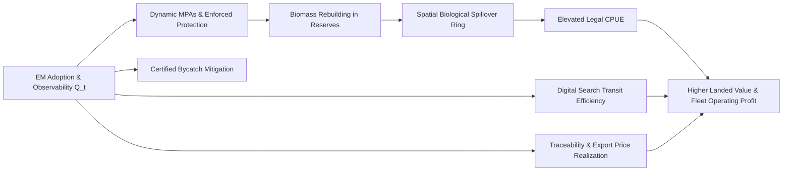

# Management, Observability, and Coupled MPA Dynamics

## 1. Overview: The Twin Roles of Electronic Monitoring

In the coupled simulator, Electronic Monitoring (EM) fulfills two distinct, mutually reinforcing functions:

1. **Compliance & Behavioral Internalization Role:** EM-equipped vessels internalize maritime regulations through onboard cameras and audit transparency. This lowers latent non-compliance propensity ($p^{\text{viol}}_{it}$), increases legal aversion away from marine sanctuaries, and enforces verified bycatch mitigation gear (circle hooks, tori lines, night setting).
2. **Information & Management Observability Role ($Q_t$):** Fleetwide EM coverage provides managers and science bodies with high-fidelity, auditable catch-and-effort data. This observability improves effort control, optimizes dynamic MPA demarcations, secures export market access, and reduces wasteful search transit.

The central thesis of the digital twin is not that "MPAs generate revenue automatically," but rather that **digital observability transforms open-access fisheries into well-managed, high-yield biological assets.**

---

## 2. Dynamic MPAs and Coupled Endogenous Demarcation

The simulator models the sharp operational contrast between **Static MPAs (BAU Twin)** and **Coupled Dynamic MPAs (EM Twin)**:

### Static MPAs (BAU Scenario)
- Marine reserve perimeters remain frozen at historical baseline coordinates across all simulation years.
- As ocean temperatures increase under climate anomaly paths $c_t$, pelagic tuna and swordfish shift poleward, and commercial fleets follow them. Because static MPAs cannot track migratory shifts or fleet congestion, target biomass and vulnerable species remain unprotected outside reserve perimeters.
- **Sanctuary Leakage (The "Paper Park" Effect):** In BAU, enforcement surveillance is low ($Q_t \approx Q_0$). High-risk vessels encounter static MPAs and poach inside them with low detection probability. This illegal fishing effort directly extracts biomass from inside the reserve:
  $$
  \text{realized\_protection}(g, t) = 1.0 - 0.75 \cdot \text{effective\_mpa}(g, t) \cdot \text{compliance\_efficacy}(g, t)
  $$
  When illegal poachers fish inside the reserve, $\text{compliance\_efficacy}$ drops to 0.20–0.40, destroying the reserve's biological efficacy.

### Coupled Dynamic MPAs (EM Intervention Twin)
- Fleetwide electronic monitoring provides managers with reliable, real-time spatial observability ($Q_t$).
- Marine reserve centroids $\vec{C}_k(t)$ dynamically track the **Conservation Priority Field $\Psi(g, t)$**, calculated endogenously at every month $t$:
  $$
  \text{Depletion}(g, t) = \frac{1}{4}\sum_{s \in \{\text{YFT}, \text{BET}, \text{ALB}, \text{SWO}\}} \max\left(0, \frac{K_{sg} - B_{sg}(t)}{K_{sg}}\right)
  $$
  $$
  \text{BycatchRisk}(g) = 0.50 S_{\text{SHK}, g} + 0.30 S_{\text{TUR}, g} + 0.20 S_{\text{SEA}, g}
  $$
  $$
  \Psi(g, t) = \text{Depletion}(g, t) \cdot \left(0.35 + 0.65 \frac{E_g(t)}{\max_h E_h(t)}\right) + 0.35 \cdot \text{BycatchRisk}(g)
  $$
- Each sanctuary shifts toward the weighted center-of-gravity of depleted commercial stocks, fishing fleet congestion ($E_g(t)$), and bycatch risk:
  $$
  \vec{C}_k(t) = \vec{C}_k(t-1) + 0.22 \lambda_t \left(\vec{C}_k^{\text{target}}(t) - \vec{C}_k(t-1)\right)
  $$
  where $\lambda_t = Q_t \cdot \left(\frac{\text{Push}_{\max}}{100}\right) \cdot \min\left(1, \frac{t+1}{14}\right)$.
- Reserve perimeters expand under the digital management push parameter:
  $$
  \text{Expansion}(t) = 1.0 + \left(\frac{\text{Push}_{\max}}{100}\right) \times Q_t \times \left(\frac{t}{T_{\max}}\right) \times 0.45
  $$
- **Threat-Conditioned Spatial Invariance (No "Ghost" Expansion):** Ecologically, an MPA should only adapt boundaries and expand buffer rings in response to active extractive threats. If there are **zero active fishing vessels** operating within an MPA's interaction zone ($N_{\text{near}, k} = 0$ and fleet congestion $< 10^{-4}$ in unexploited remote ocean basins), the MPA remains strictly **static** ($\text{Expansion}_k = 1.0$, centroid anchored at baseline). (Note: Sub-Antarctic South Georgia was replaced with the Eastern Tropical Pacific's **Cocos Island & Bicentenario Marine Sanctuary / Galápagos-Cocos Swimway** to ensure 100% alignment with tropical/temperate pelagic longline fisheries). Dynamic adaptation scales proportionally to local fishing presence:
  $$
  \text{FisherThreat}_k = \min\left(1.0, \max\left(\frac{N_{\text{near}, k}}{4.0}, 15.0 \cdot \text{Congestion}_k, 0.20\right)\right)
  $$
  $$
  \text{Expansion}_k(t) = 1.0 + (\text{Expansion}_{\text{global}}(t) - 1.0) \cdot \text{FisherThreat}_k
  $$
- Natural Earth coastline collision guards ensure reserves remain in open pelagic waters without crossing onto continental landmasses.
- **Enforced Sanctuary Protection:** High compliance among EM vessels ensures $\text{compliance\_efficacy} \approx 1.0$, maintaining full 75% biological protection and allowing target biomass to rebuild.

---

## 3. Bycatch Mitigation Gear Coupling

Longliners frequently interact with vulnerable non-target megafauna:
- **Pelagic Sharks (SHK)**
- **Marine Turtles (TUR)**
- **Seabirds (SEA)**

Under EM, onboard cameras and dockside audits verify the mandatory deployment of certified bycatch mitigation technologies:
1. **Large Circle Hooks (16/0–18/0):** Prevent sea turtles and sharks from deep swallowing hooks, reducing incidental mortality by 40%–55%.
2. **Bird-Scaring Streamer (Tori) Lines & Weighted Swivels:** Deter albatrosses and petrels from attacking sinking baits during longline setting, reducing seabird bycatch by 50%.
3. **De-Hooking & Resuscitation Equipment:** Facilitates live release of hooked megafauna.

The simulator couples EM adoption and management quality directly to vessel-level bycatch mitigation:

$$
\text{mitigation}_{i, c} = 1.0 - \mu_c \cdot \mathbf{1}_{\{\text{em}_i \land \neg \text{illegal}_i\}} \cdot \left(0.50 + 0.50 \frac{Q_t}{\max(Q_0, 0.01)}\right)
$$

Vessels equipped with EM achieve verified bycatch reductions of 35%–55%, protecting marine biodiversity while avoiding international trade embargoes.

---

## 4. Bioeconomic Transmission Channels & Reform Dividends

The model couples fisheries management ($Q_t$) directly to fleet economic returns through four validated transmission channels:

1. **Biological Spillover & CPUE Dividend:** High-protection sanctuaries accumulate target biomass. Excess biomass diffuses into adjacent fishing buffer zones ($d \le 2.0 R_k$) via spatial spillover, boosting Catch-Per-Unit-Effort (CPUE) for legal fishers.
2. **Search Transit & Fuel Savings:** High spatial observability ($Q_t$) and digital e-logbooks eliminate blind search steaming, reducing fleet fuel burn by 8% to 18%.
3. **Traceability & Market Price Realization:** Verified compliance and management observability unlock premium export certification ($+5\%$ to $+14\%$) while avoiding IUU trade embargoes.
4. **Enforcement Deterrence & Resource Rent Protection:** Non-compliant entries face surveillance detection and heavy fines, preventing open-access rent dissipation and protecting legitimate fishers' profits.

This closes the bioeconomic loop:

$$\textbf{EM Coverage} \to \textbf{High Observability } (Q_t) \to \textbf{Dynamic Demarcation \& Enforcement} \to \textbf{Biomass Rebuilding \& Spillover} \to \textbf{Elevated CPUE \& Lower Fuel Costs} \to \textbf{Positive Reform Dividend ($+\Delta$ Landed Value, $+\Delta$ Fleet Profit)}.$$
